# Sticky

Home Assistant firmware for the Seeed reTerminal E1005 ("Sticky"), a 7.5-inch black-and-white e-ink screen with touch, three buttons and a battery. It has two sides:

- **Glance:** quiet pages anyone in the house can read from across the room: clock and the day, calendar, weather, reminders, a kitchen timer, guest Wi-Fi and a few slow ones (history, the year, world clock).
- **Do:** big touch tiles for the person who runs the house: air conditioning per room, the front door, the robot vacuum and the dishwasher, each with a short wizard.

The AI button switches sides. Do goes back to Glance on its own after 5 minutes.

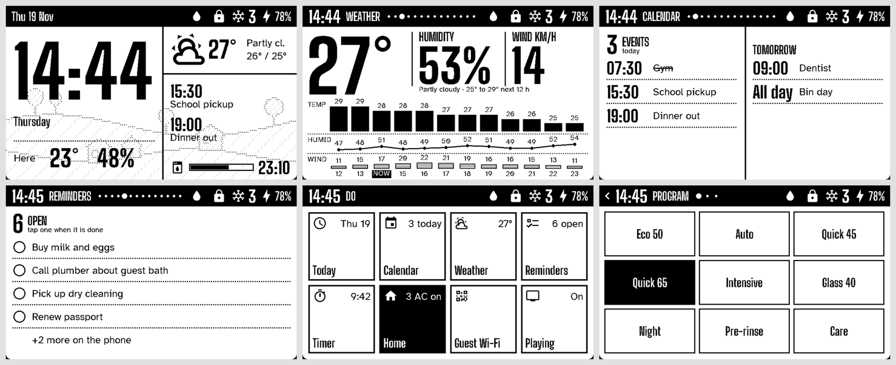

**[Try the demo](https://kingstonbenjamin.github.io/sticky/)**: press the buttons and tap the screen edges, like on the real Sticky.

It runs on ESPHome, talks to Home Assistant over its encrypted API, sleeps on battery and wakes on a button press or every few minutes to refresh.

## Screens

| Today | Calendar | Weather | Forecast |
|---|---|---|---|
| 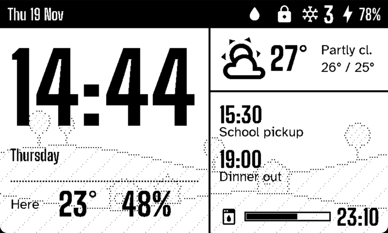 | 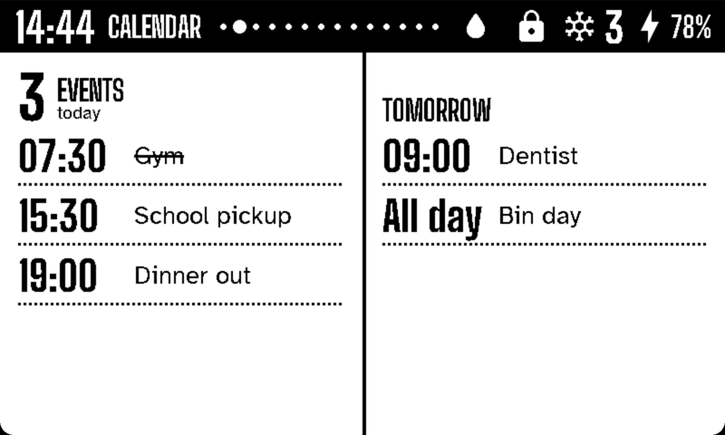 | 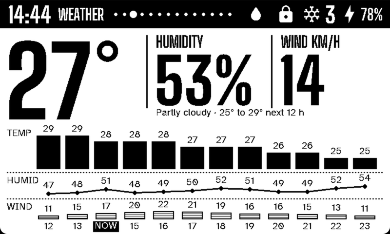 | 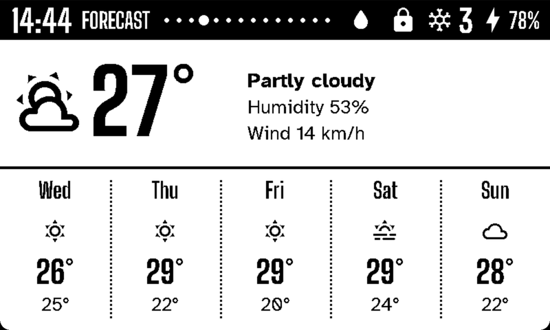 |

| Reminders | History | Year | World clock |
|---|---|---|---|
| 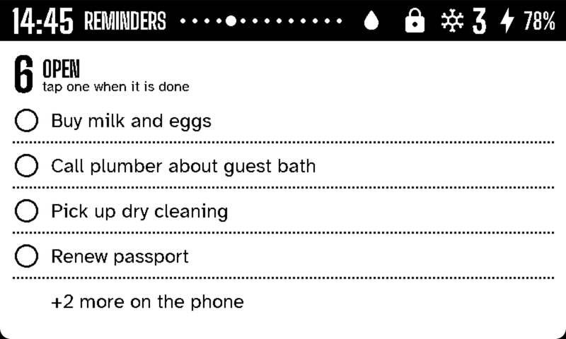 |  | 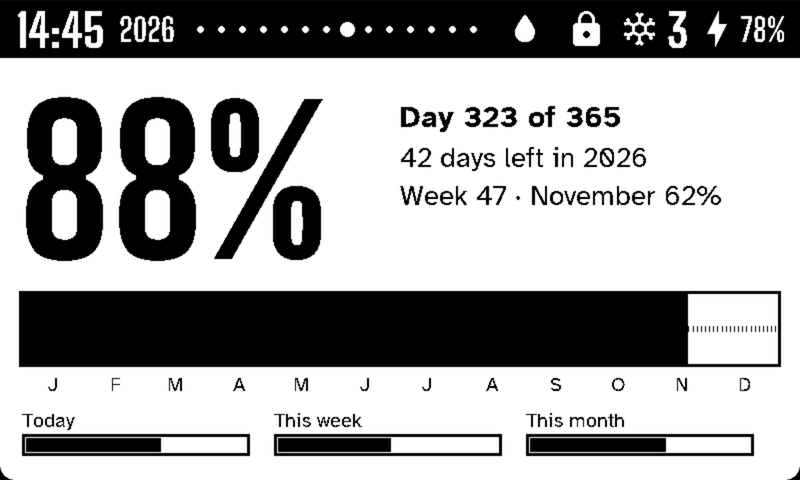 | 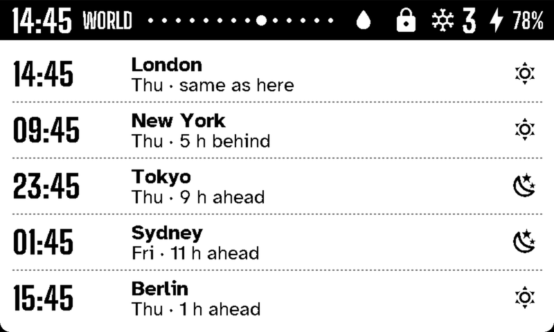 |

| Life in weeks | Biorhythm | Now playing | Kitchen timer |
|---|---|---|---|
| 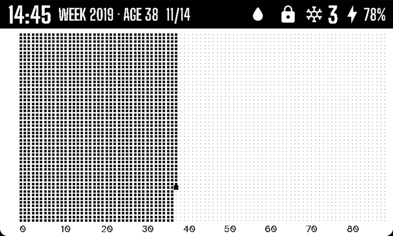 | 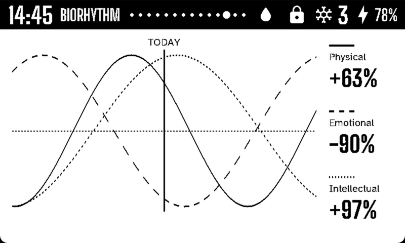 | 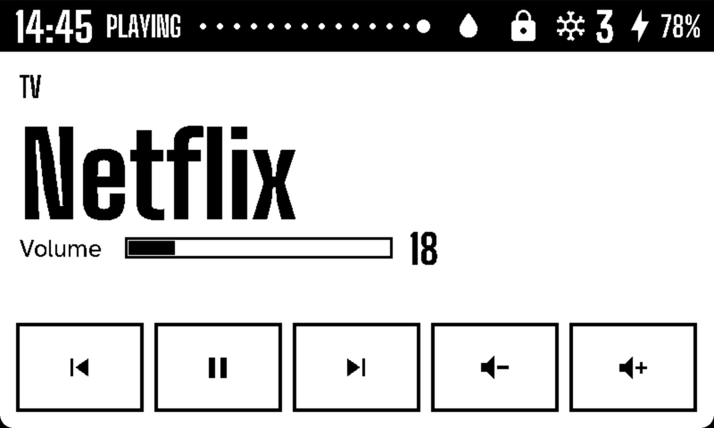 | 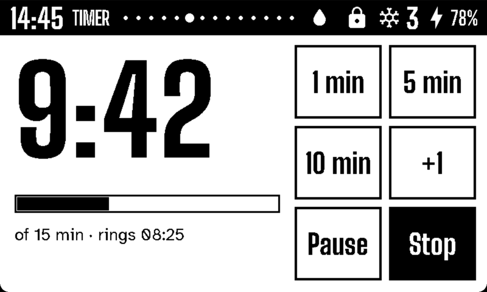 |

| Guest Wi-Fi | GitHub | Do: tiles | Do: a room's AC |
|---|---|---|---|
|  | 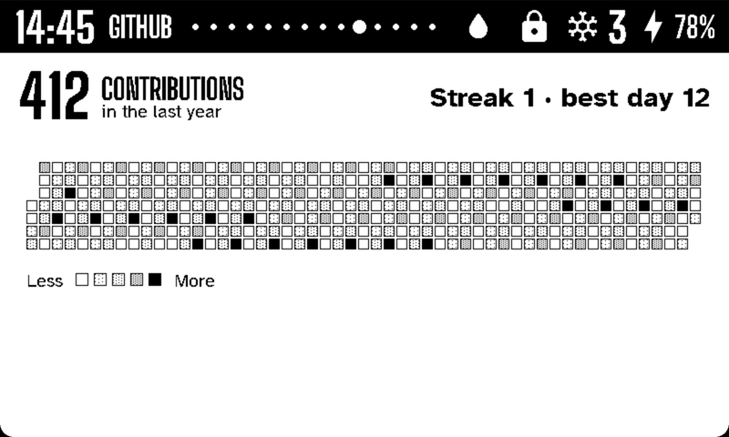 | 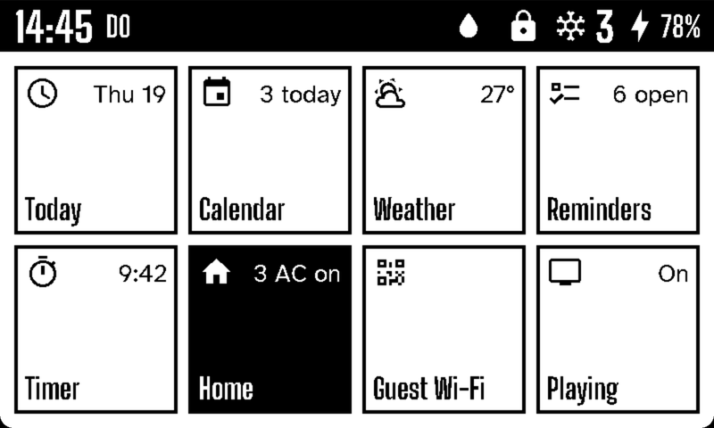 | 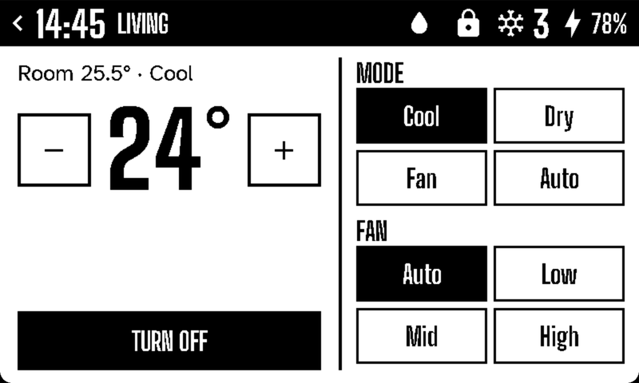 |

| Door: asks first | Dishwasher wizard | Vacuum wizard | Alert card |
|---|---|---|---|
| 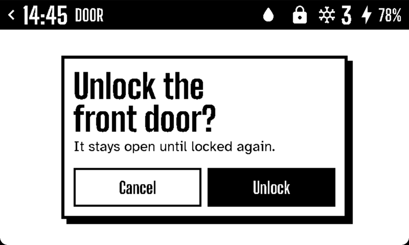 | 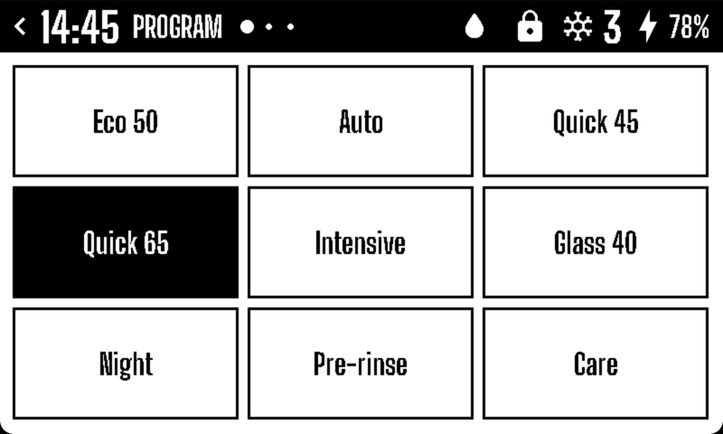 | 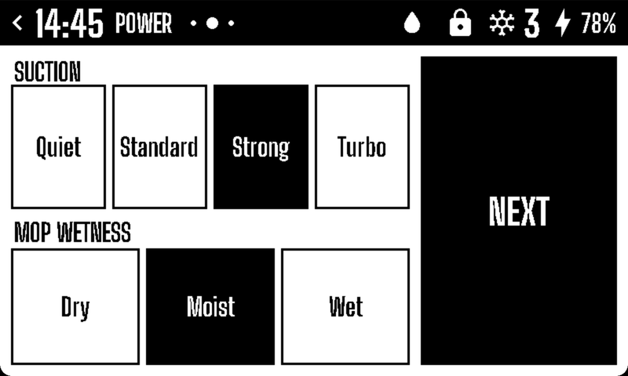 | 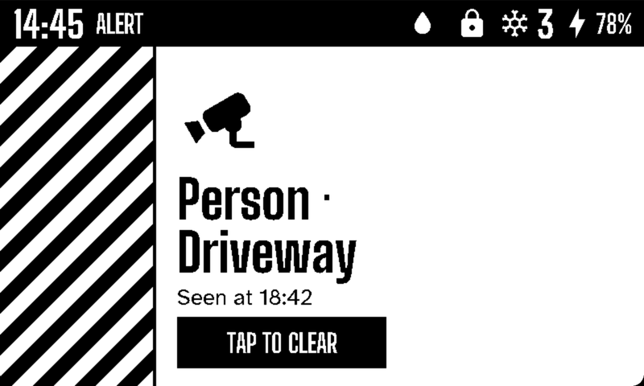 |

Turn it on its side and every screen has a portrait layout:

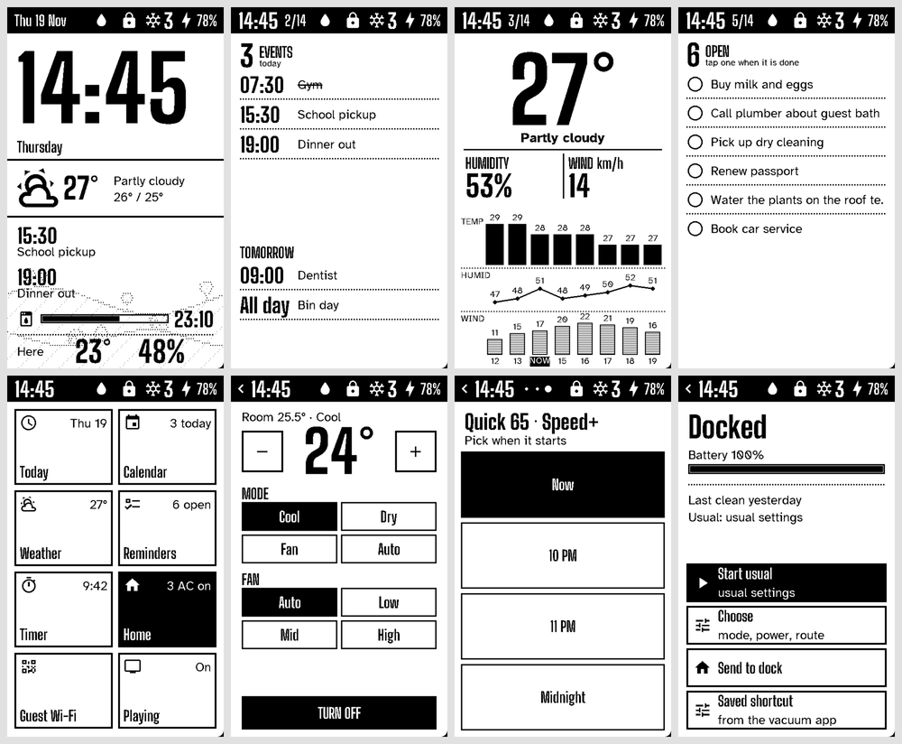

All screenshots come from the Mac preview with made-up example data (see [Try it on your computer](#try-it-on-your-computer)).

## Features

- **One big number per page,** readable from across the room: events today, open reminders, the temperature.
- **Page dots** in the top strip when you change page; they go away after 10 seconds so the screen stays calm.
- **"Updated 4 h ago"** in the strip when weather or GitHub data is old, so a frozen number never looks current.
- **Wizards with step dots:** dishwasher (program → options → start now or at 10 PM / 11 PM / midnight) and vacuum (mode → suction and mop → route, tapping a route starts it).
- **The door always asks first** on the screen before unlocking.
- **Alert cards** pushed from Home Assistant (camera, dishwasher done, timer).
- **Each page can be switched off** in Home Assistant (a switch per page on the device page).
- **Battery friendly:** deep sleep on battery, wake on any button, timed wake to refresh. Full refresh only when needed; partial refresh otherwise.
- **Made for e-ink:** black and white only, no animation, big tap targets, text that shrinks or shortens to fit instead of running off the edge.

## How it works

```
Sticky (ESPHome)  ── encrypted API ──▶  Home Assistant
  reads entities,                         sticky_do script: the only actions the Sticky may run
  draws the pages                         automations: agenda, forecast, hourly weather, reminders
```

The Sticky reads plain entities (weather, lock, vacuum, dishwasher, ACs, media players) and four short text helpers that Home Assistant automations fill (agenda, forecast, hourly weather, reminders). Every action from the Do side goes through one Home Assistant script, `sticky_do`, which refuses anything not on its list and checks every value (AC temperature 16-30, known modes and programs only).

## Hardware

- Seeed reTerminal E1005 (ESP32-S3, 32 MB flash, 8 MB PSRAM, 800 × 480 e-ink, GT911 touch, three buttons, buzzer, battery).
- A USB-C cable for the first flash. After that, updates go over Wi-Fi.

## Setup

You need ESPHome 2026.10 or newer (`pip install esphome`, or `uvx --from esphome esphome ...`) and Home Assistant.

### 1. Back up the factory firmware (recommended)
Connect the Sticky by USB and save its flash, so you can always go back:
```
esptool.py --chip esp32s3 read_flash 0 0x2000000 sticky-factory.bin
```
Keep that file private: it contains the Wi-Fi settings the Sticky had.

### 2. Home Assistant
1. Copy `ha/sticky-package.yaml` to your Home Assistant `config/packages/sticky.yaml`, and make sure `configuration.yaml` has `homeassistant: packages: !include_dir_named packages`.
2. Change the entity ids in it to yours (lock, vacuum, dishwasher, to-do list, weather).
3. Restart Home Assistant. Set `input_text.sticky_calendars` to your calendars, comma separated (for example `calendar.home, calendar.family`), and `input_text.sticky_birth_date` (YYYY-MM-DD) if you want the Life in weeks and Biorhythm pages.

### 3. Your settings
In `esphome/`:
```
cp example-home.yaml my-home.yaml           # your entities, rooms, cities, time zone
cp secrets.example.yaml secrets.yaml        # Wi-Fi, API key, OTA password
python3 art/build_history.py                # builds history_data.h (downloads 366 Wikipedia pages once)
```
`my-home.yaml` and `secrets.yaml` are git-ignored. Up to 6 ACs and 5 cities; city time zones are POSIX strings (the comments show examples). For the history page you can pick your own topics: copy `art/history_topics.example.json` to `art/history_topics.json` and change it. If you don't want history at all, run `python3 art/build_history.py --empty`.

### 4. Build and flash
```
esphome run sticky.yaml                    # first time over USB, later over Wi-Fi
```
Then add the device in Home Assistant (Settings → Devices → ESPHome) and tick **Allow the device to perform Home Assistant actions**, so the Do side can call `sticky_do`.

If the build stops with `grabRef.cmake ... head-ref`, your build folder or ESPHome's cache sits inside a git repository (for example a home folder under git). Move `build_path` in `my-home.yaml`, or tell git where to stop looking: `GIT_CEILING_DIRECTORIES=$HOME/Library/Caches esphome run sticky.yaml`.

### 5. Touch
Touch should work straight away. The firmware sends no settings to the touch chip: it uses the factory settings the chip keeps in its own memory. Home Assistant's **Touch status** shows `Ready (GT911 at 0x5D, chip settings v99)` or similar.

- Taps land in the wrong place: press **Set up touch** on the device page in Home Assistant and tap the two dots.
- **Test touch (15 dots)** measures how far each tap lands from its target, all over the screen, and shows the result. Under 30 px everywhere is good.
- Touch status says the chip **has no settings** and touch doesn't respond: this has not been seen yet. Restore your backup from step 1 to get Seeed's firmware back, and please open an issue.

## Try it on your computer

The preview draws the real screens in a window with example data, no device needed. It needs SDL2 (`brew install sdl2` on a Mac):
```
esphome compile preview/preview.yaml
```
then run the program it builds (the path is printed at the end). It steps through every screen in landscape, then portrait.

## Add-ons

Off by default, switched on at the end of `my-home.yaml`:
- **GitHub page:** your contribution graph. Sends your GitHub username to github-contributions-api.jogruber.de once a day over HTTPS.
- **Test actions:** `esphome.sticky_tap`, `sticky_press` and `sticky_show_page` let Home Assistant tap and press for automated tests.

## Security

- Wi-Fi password, API key and OTA password live only in `secrets.yaml`. Use long random values for the API key and OTA password.
- No web server on the device. The fallback hotspot only appears when the Sticky can't join your Wi-Fi, and it has a password.
- "Allow the device to perform Home Assistant actions" is all-or-nothing in Home Assistant, so this firmware only calls `script.sticky_do` and media player buttons, and the script decides what is allowed. Someone who had your OTA password or API key could flash different firmware, so keep both secret.
- Never share a built firmware file (`.bin`): it contains your secrets.

## Credits

- Built on [ESPHome](https://esphome.io) and its `epaper_spi` driver for the E1005 panel.
- Pins checked against ESPHome Designer's reTerminal Sticky hardware file and [danpodeanu/seeed-reterminal-E100X](https://github.com/danpodeanu/seeed-reterminal-E100X), whose firmware showed that the touch chip must be read by polling on this board. No code or settings from it are included.
- Fonts: [Big Shoulders Display](https://fonts.google.com/specimen/Big+Shoulders+Display) and [Atkinson Hyperlegible](https://fonts.google.com/specimen/Atkinson+Hyperlegible) (SIL Open Font License), downloaded at build time.
- Icons: [Material Design Icons](https://pictogrammers.com/library/mdi/) (Apache 2.0), downloaded at build time.
- History: Wikipedia's day pages (CC BY-SA 4.0). The text is downloaded and built on your computer and is not part of this project.
- GitHub graph data: [github-contributions-api](https://github.com/grubersjoe/github-contributions-api).

## Licence

MIT, see [LICENSE](LICENSE).
